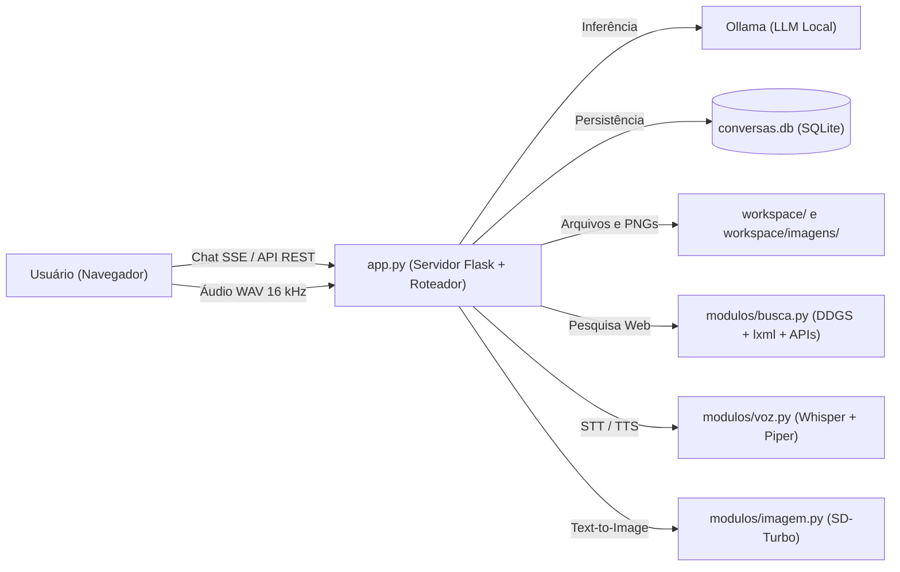
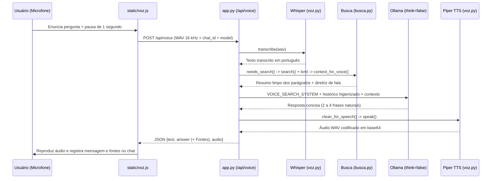
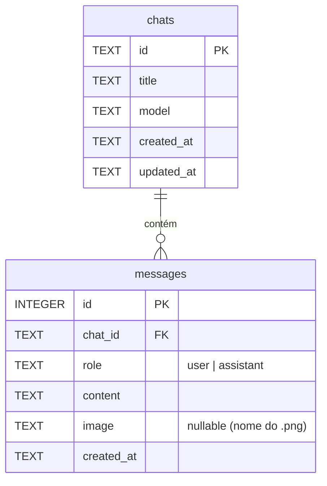

# Documentação Técnica — CodeLocal (`Agente_IA`)

Documentação técnica completa do projeto **CodeLocal**, abrangendo a evolução entre as branches `main` e `feature/imagem-voz-pesquisa`, a proveniência dos modelos de inteligência artificial empregados, a arquitetura do sistema, o esquema de banco de dados, os endpoints da API, os parâmetros de configuração e o procedimento manual de construção a partir do zero.

---

## 1. Evolução entre Branches (`main` vs. `feature/imagem-voz-pesquisa`)

### Tratamento do banco de dados `conversas.db`
- **Na branch `main`:** o arquivo binário `conversas.db` (28 KB) encontrava-se versionado no repositório Git por não constar no arquivo `.gitignore`, contendo registros locais de testes anteriores.
- **Na branch `feature/imagem-voz-pesquisa`:**
  1. O arquivo `conversas.db` foi removido do rastreamento do Git e incluído em [.gitignore](.gitignore) (juntamente com `workspace/imagens/` e `modelos_voz/`), preservando a privacidade dos históricos locais e evitando o versionamento de artefatos binários volumosos.
  2. Ao iniciar a aplicação (`app.py`), a função `init_db()` cria automaticamente o arquivo `conversas.db` e suas tabelas caso ainda não existam.
  3. **Compatibilidade retroativa:** caso um banco SQLite criado na branch `main` seja reutilizado, `init_db()` inspeciona o esquema da tabela `messages` via `PRAGMA table_info(messages)` e executa automaticamente a migração `ALTER TABLE messages ADD COLUMN image TEXT`, preservando integralmente o histórico existente.

### Comparativo técnico das alterações

| Aspecto | Branch `main` | Branch `feature/imagem-voz-pesquisa` (com melhorias locais) |
|---|---|---|
| **Escopo funcional** | Chat de texto e programação via Ollama | Chat + **Pesquisa na internet** + **Conversa por voz** + **Geração de imagens** |
| **Persistência (SQLite)** | `conversas.db` versionado no Git, sem suporte a imagens | `conversas.db` ignorado pelo Git, criado e migrado automaticamente com coluna `image` |
| **Organização do código** | Lógica concentrada em `app.py` | Arquitetura modularizada com o pacote `modulos/` (`busca.py`, `voz.py`, `imagem.py`) |
| **Interface web (Frontend)** | Chat textual e salvamento de arquivos | Seletor de modo (*Automático*, *Código*, *Imagem*, *Pesquisa web*), seletor de proporção, botão de voz com overlay interativo (`static/voz.js`) e visualização/download de imagens |
| **Dependências** | `Flask` e `requests` | Base em [requirements.txt](requirements.txt) (`Flask`, `requests`, `ddgs`, `faster-whisper`, `piper-tts`) e extensão opcional de imagem em [requirements-imagem.txt](requirements-imagem.txt) (`torch`, `diffusers`, `transformers`, `accelerate`) |
| **Refinamentos recentes** | — | Extração estrutural de HTML com `lxml` em `busca.py`, contexto dedicado `context_for_voice()` e `VOICE_SEARCH_SYSTEM`, higienização ampliada em `clean_for_speech()`, parâmetro `think: False` para compatibilidade com modelos `qwen3` e automação via [iniciar_e_testar.bat](iniciar_e_testar.bat) |

---

## 2. Origem e Proveniência dos Modelos e Serviços Utilizados

Todos os modelos de inteligência artificial do projeto são de código/pesos abertos e executados **localmente** no equipamento do usuário, sem dependência de chaves pagas de APIs proprietárias:

| Componente | Modelo / Artefato | Organização de Origem | Fonte de Distribuição / Biblioteca | Armazenamento Local |
|---|---|---|---|---|
| **LLM padrão (código)** | `llama3.2:1b` | **Meta AI** | Registro oficial do **Ollama** (`ollama.com/library/llama3.2`) | Cache interno do Ollama (`~/.ollama/models/`) |
| **LLMs instalados no ambiente** | `qwen3:4b-instruct-2507-q4_K_M`, `qwen3:1.7b`, `qwen3-chat:4b`, `qwen3-agent:1.7b`, `qwen2.5-coder:3b` | **Alibaba Cloud (Qwen Team)** | Registro do **Ollama** (`ollama.com/library/qwen3`, `qwen2.5-coder`) | Cache interno do Ollama (`~/.ollama/models/`) |
| **Reconhecimento de Fala (STT)** | `faster-whisper-base` (baseado no Whisper `base`) | Arquitetura original **OpenAI**; conversão CTranslate2 pela **Systran** | **Hugging Face Hub** (`Systran/faster-whisper-base`) via biblioteca `faster-whisper` | `modelos_voz/whisper/` |
| **Síntese de Fala (TTS)** | `pt_BR-faber-medium` (Piper VITS / ONNX) | Projeto **Rhasspy / Open Home Foundation** | **Hugging Face Hub** (`rhasspy/piper-voices`) via biblioteca `piper-tts` | `modelos_voz/` (`.onnx` e `.onnx.json`) |
| **Geração de Imagens (Text-to-Image)** | `stabilityai/sd-turbo` (precisão `fp16`) | **Stability AI** | **Hugging Face Hub** (`stabilityai/sd-turbo`) via biblioteca `diffusers` (**Hugging Face**) | Cache do Hugging Face (`~/.cache/huggingface/`) |
| **Pesquisa Web e Dados em Tempo Real** | DuckDuckGo, AwesomeAPI e Open-Meteo | **DuckDuckGo**, **AwesomeAPI** e **Open-Meteo** | Pacote `ddgs` e requisições HTTP REST diretas (`requests`) | Não armazena modelos (consulta sob demanda com acesso à internet) |

---

## 3. Visão Geral e Arquitetura do Sistema

O **CodeLocal** é uma aplicação web local baseada em **Flask** (Python) que orquestra cinco subsistemas integrados:

1. **Inferência de Linguagem (Ollama):** processamento de texto, geração/revisão de código, sumarização de buscas e diálogo por voz.
2. **Mecanismo de Busca Web (`modulos/busca.py`):** consulta a APIs de dados em tempo real (cotações e meteorologia) e buscas no DuckDuckGo com extração limpa de conteúdo HTML via `lxml`.
3. **Reconhecimento de Fala — STT (`modulos/voz.py`):** transcrição local de áudio WAV 16 kHz em português via `faster-whisper` na CPU.
4. **Síntese de Fala — TTS (`modulos/voz.py`):** conversão de texto limpo em áudio WAV em português brasileiro via `piper-tts` na CPU.
5. **Geração de Imagens (`modulos/imagem.py`):** síntese de imagens via `SD-Turbo` em 2 passos (ou integração opcional com WebUI externo).



---

## 4. Estrutura de Arquivos do Projeto

### Backend (Python / Flask)
- **[app.py](app.py):** núcleo da aplicação. Inicializa o Flask e o banco SQLite (`init_db()`), implementa o roteador automático (`wants_image`, `busca.needs_search`), traduz prompts de imagem (PT → EN) descarregando o LLM da VRAM (`keep_alive: 0`), serve respostas em streaming SSE (`/api/generate`), coordena turnos de voz (`/api/voice`) e protege a gravação de arquivos em `/api/save`.
- **[modulos/__init__.py](modulos/__init__.py):** arquivo marcador do pacote `modulos`.
- **[modulos/busca.py](modulos/busca.py):** módulo de pesquisa web. Implementa detecção de necessidade de busca (`needs_search`), consultas instantâneas de cotações (`_currency`) e meteorologia (`_weather`), busca via `ddgs`, download paralelo das páginas principais (`enrich`), extração estrutural de parágrafos com `lxml.html` (`_extract_with_lxml`), seleção de trechos relevantes (`_relevant_part`) e formatação de contexto específica para chat (`context_for_model`) e para voz (`context_for_voice`).
- **[modulos/voz.py](modulos/voz.py):** módulo local de áudio. Realiza carregamento sob demanda de `faster-whisper` e `piper-tts` (`_load`), conversão de WAV para array NumPy sem dependência de `ffmpeg` (`_wav_to_array`), transcrição (`transcribe`), higienização textual (`clean_for_speech`) e síntese de voz (`speak`).
- **[modulos/imagem.py](modulos/imagem.py):** módulo de geração de imagens. Carrega `stabilityai/sd-turbo` sob demanda com otimizações para GPUs de baixa VRAM (`enable_model_cpu_offload`, `enable_attention_slicing`, `enable_vae_slicing`) ou execução em CPU, além de suportar backend externo (`IMAGE_BACKEND=webui`).

### Frontend (HTML / CSS / JavaScript nativo)
- **[templates/index.html](templates/index.html):** estrutura da interface web (barra lateral de histórico, barra superior com seletor de modelo e tema, área de conversa, compositor com seleção de modo/proporção, overlay de voz `#liveOverlay` e diálogo de salvamento `#saveDialog`).
- **[static/app.js](static/app.js):** controle de estado da interface, consumo da API REST, leitura incremental de eventos SSE (`ReadableStream`), escape seguro de HTML contra XSS (`escapeHtml`), exportação de conversas em Markdown e integração com o módulo de voz.
- **[static/voz.js](static/voz.js):** captura contínua do microfone via Web Audio API (`AnalyserNode`), detecção automática de início de fala e pausa de silêncio, reamostragem no cliente para WAV 16 kHz mono (`OfflineAudioContext`) e interrupção de reprodução ao falar por cima (*barge-in*).
- **[static/style.css](static/style.css):** estilização responsiva, suporte a temas claro/escuro e animações do indicador de voz.

### Automação, Configuração e Dados
- **[iniciar_e_testar.bat](iniciar_e_testar.bat):** script Windows responsável por iniciar o Ollama e o servidor Flask em segundo plano e executar testes ponta a ponta automatizados.
- **[requirements.txt](requirements.txt)** e **[requirements-imagem.txt](requirements-imagem.txt):** listas de dependências Python.
- **[.gitignore](.gitignore):** exclui `.venv/`, `__pycache__/`, `.env`, `conversas.db`, `workspace/imagens/` e `modelos_voz/`.

---

## 5. Fluxos Operacionais

### Fluxo de Conversa por Voz com Pesquisa Web



### Fluxo de Geração de Imagens
1. O roteador (`wants_image`) identifica a intenção de geração de imagem por palavras-chave ou por classificação breve via Ollama.
2. `build_image_prompt()` remove prefixos de comando, traduz a descrição para o inglês utilizando exemplos *few-shot* e envia `keep_alive: 0` para liberar a memória de vídeo ocupada pelo LLM.
3. `imagem.generate()` executa o modelo `SD-Turbo` em 2 passos, salva o arquivo PNG em `workspace/imagens/<uuid>.png` e registra o nome do arquivo na tabela `messages`.

---

## 6. Banco de Dados (`conversas.db`)

O sistema utiliza **SQLite** com integridade referencial ativa (`PRAGMA foreign_keys = ON`) e exclusão em cascata (`ON DELETE CASCADE`):



---

## 7. Especificação dos Endpoints da API

| Método | Rota | Descrição |
|---|---|---|
| `GET` | `/` | Renderiza a interface web principal (`templates/index.html`) |
| `GET` | `/api/models` | Consulta `/api/tags` no Ollama e retorna a lista de modelos disponíveis |
| `GET` | `/api/status` | Retorna a disponibilidade dos módulos de imagem e voz |
| `GET` | `/api/chats` | Lista as conversas salvas ordenadas por data de atualização decrescente |
| `POST` | `/api/chats` | Cria uma nova conversa no SQLite |
| `GET` | `/api/chats/<chat_id>` | Retorna os metadados e o histórico de mensagens da conversa |
| `DELETE` | `/api/chats/<chat_id>` | Remove a conversa e todas as mensagens associadas |
| `POST` | `/api/generate` | Gera resposta em streaming SSE (texto, pesquisa web ou imagem) |
| `POST` | `/api/voice` | Executa um turno completo de áudio (STT → LLM/busca/imagem → TTS) |
| `POST` | `/api/save` | Salva um novo arquivo em `workspace/` em modo exclusivo (sem sobrescrita) |
| `GET` | `/imagens/<name>` | Entrega uma imagem PNG gerada (nome validado por regex hexadecimal) |

---

## 8. Configuração Detalhada de Cada Componente

### 1. Ambiente Python e Hardware
- **Interpretador:** Python `3.12.10` em ambiente virtual isolado (`Agente_IA/.venv`).
- **Pacotes base ([requirements.txt](requirements.txt)):** `Flask`, `requests`, `ddgs` (inclui `lxml`), `faster-whisper` e `piper-tts`.
- **Pacotes de imagem ([requirements-imagem.txt](requirements-imagem.txt)):** `torch`, `diffusers`, `transformers` e `accelerate`.
- **Aceleração de GPU:** em equipamentos com GPU NVIDIA (ex.: GeForce GTX 1050 3 GB) e driver compatível com CUDA `12.1+`, o PyTorch `cu121` ativa inferência em `float16` com offload de VRAM. Em drivers mais antigos (como `457.49` / CUDA `11.1`), o sistema recorre automaticamente à execução em CPU (`float32`), preservando o funcionamento integral sem falhas.

### 2. Servidor Web (`Flask` — [app.py](app.py))
- **Escuta:** `host="127.0.0.1"`, `port=5000`, `debug=False`.
- **Limite de requisição:** `MAX_CONTENT_LENGTH = 10 MB` para acomodar envios de áudio WAV.
- **Streaming SSE:** `mimetype="text/event-stream"` com cabeçalhos `Cache-Control: no-cache` e `X-Accel-Buffering: no`.
- **Segurança de arquivos:** `/api/save` rejeita caminhos absolutos e sequências `..` (*path traversal*), valida o confinamento em `workspace/` e utiliza abertura exclusiva (`open("x")`).

### 3. Motor de Linguagem (`Ollama` — [app.py](app.py))
- **Endpoint local:** `http://localhost:11434` (`/api/tags` e `/api/chat`).
- **Parâmetros por operação:**
  - **Chat (`/api/generate`):** `stream=True`, `num_ctx=4096`, `num_predict=3000`, `temperature=0.2`, `keep_alive="30m"`, histórico das últimas 6 mensagens.
  - **Voz (`/api/voice`):** `stream=False`, `think=False`, `num_ctx=4096`, `num_predict=320`, `temperature=0.25` (com pesquisa) ou `0.4` (conversa livre), histórico das últimas 4 mensagens higienizadas (limite de 400 caracteres cada).
  - **Roteamento e tradução de imagem:** `stream=False`, `think=False`, `num_ctx=2048`, `num_predict=100`, `temperature=0.1` e `keep_alive=0`.

### 4. Pesquisa na Internet ([modulos/busca.py](modulos/busca.py))
- **Gatilho automático:** lista `SEARCH_WORDS` avaliada por `needs_search()`.
- **Consultas diretas em tempo real (timeout 6 s):** `economia.awesomeapi.com.br` (cotações) e `open-meteo.com` (geocodificação e clima).
- **Busca web (`ddgs`):** região `br-pt` com retentativas, `timelimit="w"` para notícias, limite de 5 resultados no chat e 4 no modo voz.
- **Extração de conteúdo:** download paralelo de 2 páginas (`ThreadPoolExecutor`, timeout 6 s), correção automática de codificação, remoção via `lxml.html` de scripts, estilos, menus, rodapés, comentários HTML e blocos de referência, e recorte de parágrafos relevantes (`PAGE_CHARS = 1500` para texto; `VOICE_SOURCE_CHARS = 420` para voz).

### 5. Conversa por Voz ([static/voz.js](static/voz.js) e [modulos/voz.py](modulos/voz.py))
- **Cliente (`voz.js`):** captura de microfone com `echoCancellation`, `noiseSuppression` e `autoGainControl`; análise de amplitude via `AnalyserNode` (`fftSize = 1024`), limiar de fala `0.035`, pausa de encerramento `1000 ms`, duração mínima `350 ms`, interrupção (*barge-in*) acima de `0.07` por `250 ms` e reamostragem local para WAV 16 kHz mono PCM 16-bit.
- **Servidor (`voz.py`):** `faster-whisper` (`base`, `device="cpu"`, `compute_type="int8"`, `language="pt"`, `beam_size=1`, `vad_filter=True`); `piper-tts` (`pt_BR-faber-medium`); controle de concorrência com `threading.Lock()` e limpeza pré-síntese via `clean_for_speech()`.

### 6. Geração de Imagens ([modulos/imagem.py](modulos/imagem.py))
- **Backend local:** `stabilityai/sd-turbo` (`variant="fp16"`, `STEPS = 2`, `guidance_scale = 0.0`), com offload de VRAM na GPU ou `cpu_count - 1` threads na CPU.
- **Backend alternativo (`webui`):** requisições a `POST /sdapi/v1/txt2img` em `IMAGE_API_URL` (`20` passos, `cfg_scale = 6`).
- **Resoluções:** `quadrado` (`512×512`), `paisagem` (`640×384`) e `retrato` (`384×640`).

---

## 9. Procedimento Manual de Construção a partir do Zero

Para construir e configurar o projeto manualmente desde o início, execute as etapas abaixo em sequência:

### Etapa 1 — Preparação do Ambiente e Dependências
1. Instale o **Python 3.12** (com a opção *"Add to PATH"* habilitada) e o **Ollama**.
2. Baixe o modelo de linguagem desejado no Ollama:
   ```powershell
   ollama pull qwen3:4b-instruct-2507-q4_K_M
   ```
3. Crie a estrutura de diretórios do projeto:
   ```powershell
   mkdir Agente_IA
   cd Agente_IA
   mkdir modulos, static, templates, workspace
   ```
4. Crie o arquivo `.gitignore` excluindo `.venv/`, `__pycache__/`, `*.pyc`, `.env`, `conversas.db`, `workspace/imagens/`, `modelos_voz/` e `*.log`.
5. Crie o ambiente virtual e instale as dependências:
   ```powershell
   py -3.12 -m venv .venv
   .\.venv\Scripts\pip.exe install Flask requests ddgs faster-whisper piper-tts
   # Opcional — geração de imagens:
   .\.venv\Scripts\pip.exe install torch diffusers transformers accelerate
   ```

### Etapa 2 — Persistência SQLite (`app.py`)
Implemente `db()` (com `sqlite3.Row` e `PRAGMA foreign_keys = ON`), `init_db()` (criação das tabelas `chats` e `messages` com `ON DELETE CASCADE` e verificação automática da coluna `image`), `save_messages()` e as rotas CRUD `/api/chats` e `/api/chats/<chat_id>`.

### Etapa 3 — Servidor Flask e Streaming SSE com Ollama (`app.py`)
Implemente `/api/models` (consulta a `/api/tags`), `/api/generate` (histórico recente, `SYSTEM_PROMPT`, chamada em streaming ao `/api/chat` do Ollama retornando `text/event-stream` com `stream_with_context`) e `/api/save` (validação de caminho relativo em `workspace/` e escrita exclusiva com modo `"x"`).

### Etapa 4 — Interface Web (`templates/index.html`, `static/app.js`, `static/style.css`)
Estruture a página HTML com barra lateral, seletor de modelos/modos, compositor, overlay de voz e diálogo de salvamento. No JavaScript, consuma `/api/generate` via `fetch()` + `response.body.getReader()`, escape toda saída com `escapeHtml()` antes de renderizar blocos de código e conecte os botões de cópia, exportação e salvamento.

### Etapa 5 — Módulo de Pesquisa Web (`modulos/busca.py`)
Crie `modulos/__init__.py` e `modulos/busca.py` implementando `needs_search()`, as consultas diretas (`_currency`, `_weather`), a busca `DDGS`, o download paralelo (`ThreadPoolExecutor`), a extração estrutural com `lxml.html`, a seleção de parágrafos relevantes (`_relevant_part`) e os formatadores `context_for_model()` e `context_for_voice()`.

### Etapa 6 — Módulo de Conversa por Voz (`modulos/voz.py`, `static/voz.js` e `/api/voice`)
No frontend (`voz.js`), implemente a captura do microfone com `AnalyserNode`, detecção de silêncio, conversão para WAV 16 kHz mono via `OfflineAudioContext` e interrupção por *barge-in*. No backend (`voz.py` e `app.py`), implemente carregamento sob demanda de `faster-whisper` e `piper-tts`, transcrição em português, roteamento com `VOICE_SEARCH_SYSTEM` + `context_for_voice()` + `think: False`, limpeza em `clean_for_speech()` e síntese do áudio de resposta.

### Etapa 7 — Módulo de Geração de Imagens (`modulos/imagem.py` e `app.py`)
Implemente o carregamento sob demanda de `stabilityai/sd-turbo` com otimização de VRAM/CPU em `imagem.py`. Em `app.py`, integre o roteador `wants_image()`, a tradução *few-shot* `build_image_prompt()` com `keep_alive: 0`, a gravação em `workspace/imagens/` e a rota segura `/imagens/<name>`.

### Etapa 8 — Automação de Inicialização e Validação (`iniciar_e_testar.bat`)
Crie o script [iniciar_e_testar.bat](iniciar_e_testar.bat) (salvo com quebra de linha Windows **CRLF**) para verificar o `.venv`, iniciar `ollama serve` e `app.py` em segundo plano quando necessário, executar a bateria de testes ponta a ponta contra `/api/models`, `/api/status`, `/api/chats`, `/api/generate` e `/api/voice`, e remover a conversa temporária ao final.

---

## 10. Execução e Variáveis de Ambiente

### Execução automatizada (Windows)
Execute [iniciar_e_testar.bat](iniciar_e_testar.bat) por duplo clique ou via terminal:
```cmd
iniciar_e_testar.bat
```

### Execução manual
```powershell
cd C:\Users\contm\Music\ueg\Agente_IA
.\.venv\Scripts\python.exe app.py
# Interface disponível em: http://127.0.0.1:5000
```

### Variáveis de ambiente suportadas

| Variável | Valor Padrão | Finalidade |
|---|---|---|
| `OLLAMA_URL` | `http://localhost:11434` | Endereço base da API do Ollama |
| `OLLAMA_MODEL` | `llama3.2:1b` | Modelo de linguagem padrão |
| `OLLAMA_NUM_CTX` | `4096` | Tamanho da janela de contexto do LLM |
| `OLLAMA_NUM_PREDICT` | `3000` | Limite máximo de tokens no chat textual |
| `WHISPER_MODEL` | `base` | Variante do Whisper (`tiny`, `base`, `small`) |
| `PIPER_VOICE` | `pt_BR-faber-medium` | Identificador da voz neural do Piper TTS |
| `IMAGE_MODEL` | `stabilityai/sd-turbo` | Modelo de difusão utilizado no backend local |
| `IMAGE_STEPS` | `2` | Quantidade de passos de inferência do SD-Turbo |
| `IMAGE_BACKEND` | `local` | Modo de geração de imagem (`local` ou `webui`) |
| `IMAGE_API_URL` | `http://127.0.0.1:7860` | Endereço da API externa quando `IMAGE_BACKEND=webui` |
